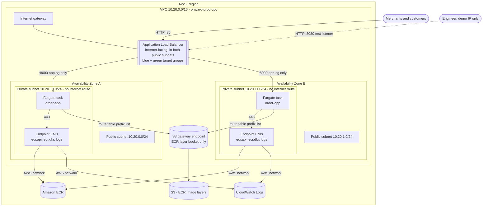
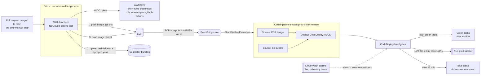
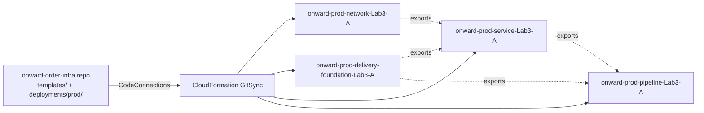

# Architecture

GitHub renders the diagrams below. Export them to PNG/SVG from https://mermaid.live if you need an image file.

## Resources inside the VPC

Security groups: `alb-sg` (80 from anywhere, 8080 from the demo IP) -> `app-sg` (8000 from `alb-sg` only; egress 443 to `vpce-sg` and S3 only) -> `vpce-sg` (443 from `app-sg` only). The private route table holds only the `local` route and the S3 gateway route; there is no NAT gateway and no `0.0.0.0/0` route.

## Delivery pipeline: how a change flows

## Infrastructure delivery (GitSync)

